<a href="https://github.com/maskentir/fakeyou"></a>

<p align="center">
  <a href="https://github.com/maskentir/fakeyou/stargazers"></a>
  <a href="#quickstart"></a>
  <a href="#architecture"></a>
  <a href="#contributing"></a>
</p>

Fakeyou is an AI twin that joins a Google Meet call as a named participant. It
transcribes every speaker, answers when it is addressed and stays quiet when it is
not. After the call it turns what it heard into a memory graph, a source-backed
debrief and a register of the decisions the meeting recorded, so the next meeting
starts from what was actually said.

It runs on your own infrastructure under the Apache-2.0 license and calls only the
speech and model providers you configure.

> [!IMPORTANT]
> Fakeyou is experimental and under active development. It supports Google Meet only
> and is not yet ready to stand in for a person in important meetings. See
> [Project direction](#project-direction) for what is shipped and what is not.

## Why Fakeyou exists


Engineering teams make most of their decisions out loud. The call ends, and what
remains is a recording nobody replays, a summary that lost who said what, and a
memory that differs from person to person. Weeks later the same question returns,
and the team cannot tell whether it was settled, by whom, or on what grounds.

Transcription tools capture the words but never take part. Note-taking tools
summarise after the fact but were never in the room. Fakeyou starts from the room:
the twin attends, decides when a line is meant for it, and keeps an evidence trail
from every claim back to the words that support it. A participant saying "the owner
approved it" stays a claim with a quote and a speaker label; it never becomes an
approval.

## Capabilities


| Capability | What the code does today |
| --- | --- |
| **Attends** | Joins Google Meet through CloakBrowser as a named guest, raises and lowers its hand, and posts to chat |
| **Listens** | Streams speech-to-text with speaker diarization (Muse) and removes the twin's own playback from the transcript |
| **Judges** | A turn judge decides, for every line, whether it is meant for the twin and whether the twin should answer |
| **Speaks** | Streams the reply sentence by sentence through Cartesia, MiniMax, ElevenLabs or OpenAI voices, and stops when someone talks over it |
| **Remembers** | Ingests each meeting record into a Graphiti memory graph per owner and twin, and recalls it before the reply model is called |
| **Debriefs** | Writes debriefs in a background worker; every item cites the transcript entries it comes from |
| **Records** | Lists decision claims, proposals, action items and open questions across meetings with their quotes (`GET /v1/decisions`), and links related, contradicting or superseding claims through curated decision lineage |
| **Forgets** | Erases a meeting and everything derived from it, or only the derived memory |

Experimental: perception of the shared screen, chat and meeting signals, voiceprint
enrollment (off by default), and verified-name calibration. Speaking proactively about
what the twin sees is not enabled.

## Architecture



Fakeyou is one API gateway and four worker roles, each its own process with its own
resource budget, so a slow debrief cannot affect a live meeting.

| Component | Responsibility |
| --- | --- |
| `api` | Token-authenticated REST and event stream for sessions, debriefs, decisions, owner model and forget |
| Redis streams | Job and live-session command transport between the api and the workers |
| `worker-sessions` | One meeting at a time: browser, audio, speech-to-text, turn judge, replies and voice |
| `worker-ingestion` | Turns a meeting record into memory graph episodes |
| `worker-debrief` | Writes the source-backed debrief that the decision register reads |
| `worker-reembed` | Refreshes memory graph embeddings |
| PostgreSQL | Session status, jobs, owner model revisions |
| Neo4j + Graphiti | Memory graph per owner and twin |
| Meeting records | Transcript record, debrief and decision lineage files per meeting |
| RustFS | S3-compatible storage for audio segments |
| Embeddings | Local text-embeddings inference service |



## Quickstart



You need Docker with Compose, [`uv`](https://docs.astral.sh/uv/), Node.js 22 or
newer and Python 3.12. Joining a meeting also needs accounts with the speech and
model providers you choose.

**1. Install and configure.**

```sh
git clone https://github.com/maskentir/fakeyou.git && cd fakeyou
uv sync --locked --all-groups
npm ci --ignore-scripts
cp .env.example .env
```

In `.env`, uncomment and fill in the credential block: `POSTGRES_PASSWORD` and
`FAKEYOU_DATABASE__URL` with the same password, `FAKEYOU_MEMORY__STORE__PASSWORD`,
the owner and admin API tokens, the provider keys for the roles you use, and the
storage keys (`FAKEYOU_STORAGE__BUCKET`, and `FAKEYOU_STORAGE__ENDPOINT_URL=http://127.0.0.1:9000`
for commands run on the host). The comments in `.env.example` describe each key, and
[docs/configuration.md](docs/configuration.md) covers the model roles.

**2. Start the stores and prepare them.**

```sh
docker compose --profile embeddings up -d postgres redis neo4j embeddings rustfs
uv run fakeyou db upgrade
uv run fakeyou storage init
```

The default embeddings image is built for ARM64. On an x86-64 host, set
`FAKEYOU_COMPOSE_EMBEDDINGS_IMAGE` to a CPU image for your architecture.

**3. Start the api and the workers, then create the memory indexes.**

```sh
docker compose up -d api worker-sessions worker-ingestion worker-debrief worker-reembed
export FAKEYOU_API_TOKEN=$(grep FAKEYOU_API__OWNER_TOKEN .env | cut -d= -f2)
export FAKEYOU_API_ADMIN_TOKEN=$(grep FAKEYOU_API__ADMIN_TOKEN .env | cut -d= -f2)
uv run fakeyou memory-init
uv run fakeyou check
```

**4. Send the twin into a meeting.** The `owner_id` and `twin_id` must match
`FAKEYOU_IDENTITY__OWNER_ID` and `FAKEYOU_IDENTITY__TWIN_ID` in `.env`.

```sh
curl -X POST http://127.0.0.1:8000/v1/sessions \
  -H "Authorization: Bearer $FAKEYOU_API_TOKEN" -H 'content-type: application/json' \
  -d '{"link":"https://meet.google.com/abc-defg-hij","meeting_id":"standup-1",
       "owner_id":"local_owner","twin_id":"local_twin","twin_name":"Fakeyou Twin",
       "audio":true,"conversation":true,"memory":true,
       "persona":{"owner_id":"local_owner","twin_id":"local_twin",
                  "display_name":"Fakeyou Twin","role":"Project coordinator",
                  "language":"en","allowed_tools":["recall_meeting_context"],
                  "ingest_transcripts":true}}'

curl -X POST http://127.0.0.1:8000/v1/sessions/standup-1/join \
  -H "Authorization: Bearer $FAKEYOU_API_TOKEN" -H 'content-type: application/json' -d '{}'
```

Follow it with `curl -N http://127.0.0.1:8000/v1/sessions/standup-1/events`, read the
report at `/v1/sessions/standup-1/report`, and stop it with
`POST /v1/sessions/standup-1/stop`, each with the same `Authorization` header.

<details>
<summary><strong>API reference</strong></summary>

All routes take `Authorization: Bearer <token>` with the owner or the admin token.
The running api serves interactive documentation at `http://127.0.0.1:8000/docs`, and
[docs/api.md](docs/api.md) describes the decision, lineage and owner model behaviour.

| Method | Endpoint | Purpose |
| --- | --- | --- |
| `POST` | `/v1/sessions` | Register a meeting and its persona |
| `POST` | `/v1/sessions/{id}/join` | Send the twin in |
| `POST` | `/v1/sessions/{id}/stop` | Stop the twin |
| `GET` | `/v1/sessions/{id}` | Current phase |
| `GET` | `/v1/sessions/{id}/events` | Live event stream |
| `GET` | `/v1/sessions/{id}/report` | Session report |
| `POST` | `/v1/sessions/{id}/ingestions` | Queue memory ingestion |
| `GET` | `/v1/sessions/{id}/ingestion` | The meeting's latest ingestion outcome |
| `GET` | `/v1/jobs/{id}` | One ingestion job's outcome |
| `POST` | `/v1/sessions/{id}/debriefs` | Queue a debrief |
| `GET` | `/v1/sessions/{id}/debrief` | Debrief status and report |
| `GET` | `/v1/decisions` | Decision register across meetings, with quotes |
| `GET` | `/v1/decisions/{record}/lineage` | One record's compared relationships, with both evidence trails |
| `PUT` | `/v1/decisions/lineage/{id}` | Publish a curated `decision_lineage/v1` document for one meeting |
| `POST` | `/v1/twins/{id}/reembeddings` | Queue an embedding refresh |
| `GET` | `/v1/twins/{id}/owner-model` | Active owner model, or `?version=` |
| `POST` | `/v1/twins/{id}/owner-model` | Add an item |
| `POST` | `/v1/twins/{id}/owner-model/imports` | Import persona facts and preferences once |
| `POST` | `/v1/twins/{id}/owner-model/items/{item}/revisions` | Revise an item |
| `POST` | `/v1/twins/{id}/owner-model/items/{item}/retire` | Retire an item, keeping its history |
| `DELETE` | `/v1/twins/{id}/owner-model/items/{item}` | Forget an item and erase its content |
| `GET` | `/v1/twins/{id}/owner-model/items/{item}` | Revision history |
| `GET` | `/v1/twins/{id}/owner-model/proposals` | Learned items awaiting a decision |
| `POST` | `/v1/twins/{id}/owner-model/proposals/{revision}/approve` | Approve, or `/reject` |
| `POST` | `/v1/sessions/{id}/forget` | Erase a meeting; `keep_record: true` erases derived memory only |
| `POST` | `/v1/admin/memory-init` | Create Graphiti indexes |
| `GET` | `/v1/admin/check` | Effective configuration, with secrets masked |

</details>

<details>
<summary><strong>CLI reference</strong></summary>

The `fakeyou` command is a client of the same api. It reads the owner token from
`FAKEYOU_API_TOKEN` and the admin token from `FAKEYOU_API_ADMIN_TOKEN`. Run it with
`uv run fakeyou`, or activate the virtual environment that `uv sync` created.

```sh
fakeyou check
fakeyou memory-init
fakeyou join https://meet.google.com/abc-defg-hij --meeting-id standup-1 --audio --converse
fakeyou report --meeting-id standup-1
fakeyou debrief --meeting-id standup-1
fakeyou brief standup-1 --persona .runtime/audio/persona.json
fakeyou memory-ingest --meeting-id standup-1
fakeyou memory-forget --meeting-id standup-1
fakeyou memory-reembed
fakeyou owner-model import --persona .runtime/audio/persona.json
fakeyou owner-model add position release "Ship the beta after the load test passes" --persona .runtime/audio/persona.json
fakeyou owner-model add fact acme-renewal "The Acme renewal closes on 3 March" --valid-at 2026-02-01T00:00:00+00:00 --persona .runtime/audio/persona.json
fakeyou owner-model revise ITEM_ID fact acme-renewal "The Acme renewal closes on 28 February" --valid-at 2026-02-10T00:00:00+00:00 --persona .runtime/audio/persona.json
fakeyou owner-model retire ITEM_ID --persona .runtime/audio/persona.json
fakeyou owner-model forget ITEM_ID --persona .runtime/audio/persona.json
fakeyou owner-model show --persona .runtime/audio/persona.json
fakeyou owner-model proposals --persona .runtime/audio/persona.json
fakeyou decisions import-lineage --file lineage.json
fakeyou decisions lineage RECORD_ID
fakeyou worker start https://meet.google.com/abc-defg-hij --meeting-id standup-1 --audio
fakeyou worker status standup-1
fakeyou worker stop standup-1
fakeyou diarize run --meeting-id standup-1
fakeyou diarize show --meeting-id standup-1
fakeyou audio purge-expired --days 30
fakeyou perception purge-expired --days 30
fakeyou db upgrade
fakeyou db status
fakeyou storage init
```

`db upgrade`, `storage init`, the `purge-expired` retention sweeps, `diarize show`,
`calibrate` and `voiceprint` run on the host rather than through the api, because they
touch the migration path, the local filesystem or a local ONNX model.

</details>

## Technical depth



- **Enforced layering.** Package layers and boundaries are contracts in
  [`pyproject.toml`](pyproject.toml) checked by `import-linter`; a package that imports
  one above it fails the build.
- **Strict configuration.** Every setting is one `FAKEYOU_*` schema in
  [`src/fakeyou/config/settings.py`](src/fakeyou/config/settings.py); an unknown key is
  an error, not a silent default.
- **Replayed meetings in CI.** The meeting simulator drives the whole worker against
  a fake Meet page. On every pull request it replays recorded provider cassettes with
  no secrets and no network ([docs/development.md](docs/development.md)).
- **Evidence or nothing.** When a debrief item's quote is missing from the transcript
  entry it cites, the decision register reports that debrief as invalid and serves
  none of its records ([`src/fakeyou/debrief/register.py`](src/fakeyou/debrief/register.py)).
- **Claims are not approvals.** Decision records are always `owner_approved: false`.
  The owner model, an append-only revision history in PostgreSQL, changes only through
  the owner's own writes or approved proposals.
- **Serialized persistence.** One record lock per meeting serializes forget, debrief,
  ingestion and lineage imports; curated lineage is replaced only with the current
  revision ([`src/fakeyou/debrief/lineage.py`](src/fakeyou/debrief/lineage.py)).
- **Offline evaluation before models.** Decision lineage classification is measured
  against a curated offline benchmark before any model is allowed to label
  relationships ([`evals/_decision_lineage.py`](evals/_decision_lineage.py)).

## Project direction



Fakeyou is growing from a meeting participant toward an engineering chief of staff: a
trustworthy history of what a team decided, by whom and on what evidence.

- **Shipped:** the decision register, curated decision lineage, the owner model with
  proposals that change nothing until approved, and forget with retention sweeps.
- **Evaluating:** classifying relationships between decisions with a model. A
  provisional, synthetic benchmark exists; no model has been run against it yet.
- **Ambition, not commitment:** decision intelligence across meetings, an engineering
  chief of staff, and clear boundaries for when the twin may speak for its owner.

Known limits: Google Meet only; Teams and Zoom are not implemented. A Meet
server-side overload ends the session instead of reconnecting indefinitely. Live
latency targets are kept in
[`src/fakeyou/session_targets.json`](src/fakeyou/session_targets.json) (first audio
p50 at most 3.5 s, p95 at most 6.5 s); they are targets, not measured guarantees.

## Contributing



Issues and pull requests are welcome. Please open an issue before a larger change.

1. Use the issue templates for bug reports, feature requests and live session reports.
2. Keep each pull request focused and fill in
   [the pull request template](.github/pull_request_template.md).
3. Run the gates before asking for review:

```sh
uv run --no-sync pytest
uv run --no-sync mypy
uv run --no-sync ruff check . && uv run --no-sync ruff format --check .
uv run --no-sync lint-imports
uv run --no-sync deptry .
```

Further reading: [configuration](docs/configuration.md), [API behaviour](docs/api.md),
[development and the meeting simulator](docs/development.md), and
[maintaining the README artwork](docs/readme/README.md).

## License

Fakeyou is licensed under the Apache License 2.0.
