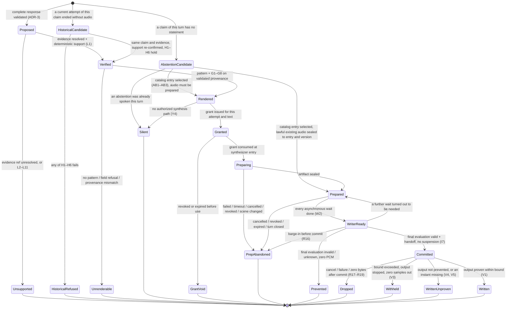

# Architecture Decision Review — preparation, physical writer, typed visual claims

Status: **REVISION 3. ADR-2 CLOSED: BOTH W-A2 PLACEMENTS REJECTED FOR V6 (see `2026-11-15-architecture-decision-closure.md`). ADR-1 AND ADR-3: DIRECTION ACCEPTED, NOTHING IMPLEMENTED.**

The ADR-2 section below is kept as written at revision 3 and is superseded by
the closure where they differ.

This review answers the CHANGES REQUIRED decision on the stack #206–#217. It
contains three decision records, one state machine and one threat model. It
changes no runtime behavior and no contract text. #205 stays authoritative;
PublicationContext stays OFF; Phase 5B NO-GO; provider requests 0; provider
spend US$0.

Revision 2 applied the first co-founder ruling (five rulings, three
corrections). Revision 3 applies the verdict on commit `3d9c784c`: three P0
findings on the writer (event ordering against corked upload, PCM crossing the
process boundary before authorization, server indices used as proof they are
not) and four sharpenings (timing intervals, first-frame deadline, cancellation
before and after commit, fallback entry into the machine).

The review of PR #218 at `b2713b85` accepted the direction of all three records
and asked for one more revision of the spike protocol only. The matching
corrections here are confined to ADR-2: the execution context of the commit
section, and playback-started reduced to a diagnostic.

| Record | Verdict on r2 | State after revision 3 | Still open |
| --- | --- | --- | --- |
| ADR-1 Preparation and publication | Design direction accepted | Unchanged in substance; silence terminology corrected | Contract amendment review; local engine evaluation |
| ADR-2 Physical writer | Spike protocol not approved | PCM zones, two variants, evidence sources corrected; protocol revised in `2026-11-15-writer-spike-protocol.md` | Protocol review; then whether any client design can prevent late output |
| ADR-3 Typed visual claims | Design direction accepted | Unchanged | Latency cost and real proposal availability, both unmeasured |

## Findings from the source that shape the decisions

Each was read at `4f5c22e2`. None is a new test result.

| # | Finding | Where | Consequence |
| --- | --- | --- | --- |
| F1 | The only objects with `local_only = True` are test doubles. `speech/registry.py` builds Cartesia, ElevenLabs, MiniMax and OpenAI adapters only | `tests/_audio_support.py:138`, `src/fakeyou/speech/registry.py` | Option A removes the contract cycle. It delivers no speech until a local engine exists |
| F2 | Local authorization is `context.runtime_synthesis == "local"` plus `getattr(synthesizer, "local_only", False)` | `audio/playback.py:747-750`, `conversation/visual_speech.py:121` | A mode string and a self-declared attribute. Any adapter can declare itself local |
| F3 | `accepted_at` is the instant the executor thread starts `_observed`. The deadline is checked, then `stream.write` blocks for an unbounded time | `audio/pulse_writer.py:78-85`, `:62-67` | Neither instant is evidence that the server holds the PCM. Nothing can withhold after the check |
| F4 | `pasimple` 0.0.3 wraps `pa_simple_*` only: blocking `write`, `drain`, `flush`, `get_latency` | `.venv/.../pasimple/pa_simple.py` | V2 cannot be met with this binding. A library limit, not a bug |
| F5 | `render` slices `answer[span.start:span.end]` from the `Support` it is handed, checking only that a span exists | `foundation/rendering.py:67-85` | A `Support` built anywhere else renders arbitrary answer text (NC-71) |
| F6 | `VisualTurn.speak` finds claims with `text.find("CLAIMS:")`. `SpeechPlan` has no visual claim field | `conversation/visual_speech.py:262`, `foundation/claims.py:122`, `conversation/reply_planner.py:55` | No production path makes the model emit the marker. Tests append it by hand |
| F7 | The streaming planner validates partial JSON drafts and releases text as it grows | `conversation/reply_planner.py:425-455` | `"$1.2"` is indistinguishable from a truncated `"$1.2M"` until the value closes |
| F8 | `verify_claim` binds a claim to the first look whose `kind` matches | `foundation/claims.py:272-276` | Wrong evidence with two looks of one kind |

## Single state machine (source of truth)

One publication attempt follows exactly this machine. Every arrow is a journaled
transition with one owner. A state not drawn here does not exist; a class that
needs another transition changes this diagram first.

A response that fails validation creates no attempt (ADR-3).

**Fallback is a new attempt with its own entry.** It has its own publication ID
and its own grant, links the attempt it replaces, and never resumes it.

| Entry | Precondition, checked by the runtime before the attempt exists | Then |
| --- | --- | --- |
| `HistoricalCandidate` | The replaced attempt carries verified provenance for the same claim and evidence; its end reason is one H5 allows; no reason excluded by H6 | Support is re-confirmed by the one matcher and H1–H6 are checked. Only then `Verified`, rendered with the historical pattern. H1–H6 are checked again at the attempt's own commit, as the contract requires. `HistoricalRefused` is terminal for this attempt; an abstention, if the catalog rules allow one, is a further new attempt and leaves this record untouched |
| `AbstentionCandidate` | No historical statement is available for the claim; the catalog condition (AB1, AB2 or AB3) is derived from the look status, never from the model | Entry and version are selected. Existing lawful audio goes to `Prepared`, sealed to entry and version; otherwise `Rendered`, needing a grant like any statement |
| retry | The earlier attempt ended in `PrepAbandoned` before commit | A new attempt at `Rendered` with a new grant |

**Silence is not abstention.** `Silent` is a terminal state: nothing is
prepared, nothing is written, and the journal records `synthesis_unavailable`
(or that an abstention was already spoken) with the statement that would have
been said. An abstention is spoken only when its attempt reaches `Written`.
With no local engine and no lawful catalog audio, every visual turn ends in
journaled silence.

**No staged state.** In this machine PCM stays in worker memory through
`Prepared` and `WriterReady` and first leaves the worker in the `Committed`
transition. Holding PCM in the audio server before the final evaluation is not a
state here; ADR-2 explains why and what would have to be reviewed to add one.

**Ownership.** One component performs each transition; nothing else may.

| Transitions | Owner | Notes |
| --- | --- | --- |
| into `Proposed` | reply planner | Only from a complete, validated structured response |
| into and out of `HistoricalCandidate`, `AbstentionCandidate` | visual turn | Derives preconditions from recorded outcomes and look status only |
| `Proposed →` `Verified` / `Unsupported` | the one matcher (`foundation.claims`) | Sole producer of provenance |
| `Verified →` `Rendered` / `Unrenderable` | renderer | Validates provenance, never produces it |
| `Rendered →` `Granted` / `Silent`; `Granted → GrantVoid` | preparation authority | Sole issuer and sole revoker |
| `Granted → Preparing`, `Preparing →` any | synthesis engine | Consumes the grant before the synthesizer is entered |
| `Prepared →` any, `WriterReady →` any | playback engine | Sole caller of the final evaluation |
| `Committed →` any | writer, reported through the receipt | Sole source of output instants |

| # | Invariant of the machine |
| --- | --- |
| M1 | Every attempt ends in exactly one terminal state with one journal record naming it. A turn that closes with a non-terminal attempt is a defect, detected at turn close |
| M2 | Only `Written` counts as spoken and enters the meeting record. `WrittenUnproven` reports local audio truthfully and is never fresh or compliant (I12, I15, V4) |
| M3 | A grant is consumed on entry to `Preparing` and stays consumed when preparation fails. No state is reachable twice with one grant |
| M4 | `Granted`, `Preparing` and `Prepared` are never publication decisions. The only publication decision is made on the `WriterReady` exit |
| M5 | No `await` between the final evaluation and the handoff. A needed wait returns the attempt to `Prepared` and the evaluation is repeated |
| M6 | A sealed artifact is consumed by at most one `Committed` transition and carries no approval |
| M7 | No state lets model-written text reach a synthesizer. The machine starts from a typed proposal, never from text |
| M8 | Revocation is honored at every state before `Committed` and produces no handoff. After `Committed` it stops further output and never rewrites the decision (I7) |

---

## ADR-1 — Preparation is separate from publication (NC-76 / I7)

### Decision

Option A of #217, for contract review. Option B is not selected. Local synthesis
is in scope as an isolated capability, and its voice may differ from the owner's
provider voice (ruling 1).

### Five invariants (ruling 5), as proposed contract wording

> **Authority.** Only a preparation authority established at the composition root
> issues a preparation grant. A grant has one purpose, one scope and one
> lifecycle. A synthesizer or adapter cannot issue, extend or copy one.
>
> **Consumption.** A grant is spent when preparation starts, whether or not
> preparation succeeds. A retry needs a new grant. A preparation grant is never a
> publication permission.
>
> **Artifact.** Prepared PCM carries no publication approval. Its identity is
> bound to the claim, evidence, source, subject, page and session, rendering
> version, language and the grant it came from.
>
> **Egress.** A synthesizer is local only where the boundary that runs it cannot
> reach a provider. A declared property, a type, or possession of a grant is not
> that proof.
>
> **Commit.** Only the final re-evaluation of the binding against the latest
> state permits a handoff. `invalid` or `unknown` hands no new current PCM to the
> writer.

These go into the #217 amendment beside its NC-76 replacement and I7
clarification. The diff against #205 is reviewed on its own before any
implementation.

### Design

**Grant.** `runtime_synthesis` and `local_only` stop being authorization inputs.
The authority is built once at the composition root around one synthesizer
endpoint. It issues a grant for one `(attempt, text digest, pattern id, pattern
version, language)`. The engine consumes it at synthesizer entry; an unknown,
spent, void or mismatched grant is refused with a reason.

**Limit of the grant, stated.** An object capability in one Python process stops
accidental and configuration-driven use. It is not a sandbox against code that
already executes in the process. It is therefore never the only protection.

**Egress boundary.** The local engine runs outside the worker process:

| Layer | Control | What it proves |
| --- | --- | --- |
| Operating system | Engine in its own process or container with no network namespace route out (no egress policy; no provider credentials mounted); reached over a local socket | The engine cannot make a provider request whatever its code does |
| Dependency | Engine image built without the provider SDKs and HTTP clients; import-boundary check in CI | A regression is caught before deployment |
| Composition | The authority accepts only that endpoint type; registry adapters and `SpeechWithFallback` are ineligible | No fallback route to a provider exists in the wiring |
| Capability | Grant consumed per preparation | No preparation without a decision to prepare |

The first row is the proof. The others are defence in depth.

**Local engine as a plugin (ruling 1).**

- Voice selection is configuration of the engine. It has no part in
  authorization, and authorization does not depend on which voice is loaded.
- Requirements to evaluate: EN and ID; hard preparation timeout 2 s; p95 target
  ≤ 1 s (both initial experiment targets, not benchmark results and not contract
  values); memory and CPU limits set on the container.
- With the engine absent the machine takes `Rendered → Silent`: journaled
  silence, not a spoken abstention. Nothing else in the product depends on the
  engine, Decision Memory included.
- No engine is selected here. Candidates, licences and EN/ID quality are an
  evaluation of their own.

**Artifact.** `Prepared` seals:

`preparation_id, grant_id, text_digest, pcm_digest, pattern_id, pattern_version,
language, claim_digest, evidence_ref, evidence_ids, gather_attempt_id,
page_epoch, session_id, source_identity, subject_identity, sealed_at`

At `WriterReady` the engine derives the same tuple from the current verified
claim and binding. Any inequality prevents the handoff. Same text with different
evidence is a different artifact.

**Abandonment is an outcome.** `PrepAbandoned` records the cause, whether the
synthesizer was entered, and zero PCM handed off. The artifact is released then,
with no claim of secure memory erasure.

### Controls

NCA-01 to NCA-20 as drafted in #217, plus:

| ID | Scenario | Required result |
| --- | --- | --- |
| NCA-21 | Adapter with a network transport declares itself local by attribute, subclass or wrapper | No grant; refused before synthesizer entry |
| NCA-22 | Grant reused: second text, second attempt, after a failed preparation, after revocation | Refused; journaled |
| NCA-23 | Artifact tuple differs from the derived tuple in exactly one field, for each field | No handoff, for every field |
| NCA-24 | Turn closes with an attempt in a non-terminal state | Reported as a defect; never silent |
| NCA-25 | Preparation exceeds 2 s | `PrepAbandoned: timeout`; work cancelled; zero PCM |
| NCA-26 | Local engine process attempts an outbound connection | Fails at the operating-system boundary; test runs against the real isolation, not a mock |
| NCA-27 | Revocation in `Granted`, `Preparing`, `Prepared`, `WriterReady` | No handoff from any of them; terminal state recorded |

### Rejected alternatives

| Alternative | Reason |
| --- | --- |
| Keep the mode string with more checks | F2: the checked value is the one a misconfiguration controls |
| In-process local engine guarded by the grant alone | Fails the egress invariant |
| Pre-synthesized catalog of all values | Unbounded value space; catalog building is synthesis and needs the same grant |

---

## ADR-2 — Physical writer (V6)

Status: **no design selected.** The ruling authorizes an offline spike of the
libpulse asynchronous API and nothing else. Guard band plus honest
classification is **not** accepted as satisfying V2.

### Where PCM is, and what authorizes it to be there

Revision 2 proposed uploading PCM to the server while the stream is corked,
then evaluating and uncorking. That put PCM in another process before the final
evaluation and relied on the server's cork state to keep it silent. Cork is a
playback control, not an authorization. It is withdrawn as the candidate design.

| Zone | Where the PCM is | What may put it there | What keeps it from being heard |
| --- | --- | --- | --- |
| Z0 Prepared | Worker memory only | A consumed preparation grant | It has not left the process. Provable inside the runtime |
| Z1 Staged | Audio server buffer, playback not permitted | Nothing in #205. I7 makes the handoff part of the commit, so a handoff before the final evaluation is outside the contract as written | Only the server's cork state, which the runtime does not own |
| Z2 Released | On its way to the sink | A final evaluation that returned `valid`, in the same non-suspending section | Nothing; this is output |

**Rule for this review:** current-scope PCM goes from Z0 to Z2. Z1 is not used.
Using it would need a contract review of I7 and a proof that staged audio can
never play without a commit, across server restart, delayed commands and
release ordering. No such proof is known.

### Variants of the asynchronous writer

| | W-A2 — release is the write | W-A1 — stage, then release |
| --- | --- | --- |
| Before the final evaluation | Stream connected, running, empty. No PCM outside the worker | First frame uploaded to a corked stream (Z1) |
| Commit section | One synchronous function on the thread that owns both the evaluation and libpulse: readiness re-check, final evaluation, non-blocking write of the first frame. No lock, no hop to another thread, and no mainloop iteration inside it, so no libpulse callback runs between evaluation and write. Sending to the server is a separate postcommit phase | Final evaluation, then an uncork request |
| Final evaluation not `valid` | Nothing was handed over; nothing to undo | Staged PCM must be destroyed in another process, by asynchronous commands |
| Fits I7 as written | Yes | No |
| Latency after commit | Transport of the frame plus server start | Start only |
| Standing | **Candidate** | Characterization arm in the spike only; cannot be put forward for V6 |

W-A1 is measured because its latency advantage is the reason it was proposed,
and the cost of giving it up should be a number.

### Events and what counts as evidence for each

`first_written_at` keeps its contract meaning. No field below is renamed to it
or mapped onto it here; which event satisfies V1 is for contract review. The
revision 2 proposal to evaluate V1 at a read-index event is withdrawn.

| Event | Evidence accepted | Not evidence |
| --- | --- | --- |
| Client enqueue | The write call returned success. A local fact | — |
| Server processed the write | The reply to a timing request issued after the write, and only if an argument from the daemon source shows that reply cannot precede processing of the write. Sharing a connection is not that argument. The reply gives no instant, only an interval, and a late reply is not a false one | The local `write_index`, which the client library advances at the write call. The playback-started notification, which reports a start after underrun and acknowledges no frame; it is diagnostic only |
| Buffer read | A timing snapshot requested after the release, not flagged corrupt, whose read index is past the clip start. It shows the stream buffer was read | Interpolated time or latency. A read index is not sink output: latency remains downstream of it |
| Sink output | An independent recorder on `agent_output.monitor` identifying the clip's own samples, reported as a time interval with measured uncertainty | The writer's own bookkeeping, or any of the rows above |

A missing or invalid item is `unproven`. It is never filled from another row.

### Candidates

| | W-A2 — libpulse asynchronous stream | W-B — worker around the blocking API | W-C — non-blocking FIFO handoff |
| --- | --- | --- | --- |
| Blocking write | Reported, not waited on (to be shown) | Occurs; not interruptible | `EAGAIN` |
| Acceptance point | Non-blocking write inside the commit section | A queue, not the device | Kernel pipe |
| Stop after deadline | Flush and cork are asynchronous commands | Kill the worker | Nothing beyond the pipe buffer |
| Evidence of output | Monitor observation only | None | None |
| Status | Spike **not yet authorized**; protocol under review | **Rejected for V6** (F4) | Spiked only if it offers a more controllable boundary; a FIFO is not by itself bounded physical output |

### Deadlines and stops

- **First frame.** V1 bounds the first successful write against the final
  evaluation and the sample's freshness. That is the only output deadline in
  #205. A clip whose first sample did not meet it must produce no sample at all
  (V2, V3).
- **Rest of the clip.** No deadline in #205: after the commit the decision
  stands and later evidence is post-commit. A per-frame freshness bound would be
  a new design requirement. It is not proposed here; continuation timing is
  recorded for information.
- **Before commit.** Revocation or cancellation means zero output. With Z1
  unused this is a fact about worker memory.
- **After commit.** The commit is not rolled back. A stop means no further PCM
  is released. Audio already handed over may still play: what is unread in the
  stream buffer, and what was already read into the sink path. No bound on the
  second is known, so no bound on post-stop output is claimed; the receipt
  reports what left.

### What the spike must falsify

A percentile is not a safety invariant, and a run without violations is not a
guarantee. The spike has to produce both fault-injection results and a design
argument naming where authorization and the physical boundary coincide.

The decisive question is prevention, not latency:

> After the deadline, can the writer make it impossible for a sample of that
> frame to be consumed by the sink?

Analysis before any measurement, recorded so it can be proven wrong: every
candidate hands PCM or a start command to another process. If that process
stalls after the handoff and resumes after the deadline, the client's stop
request is one more queued command with no ordering guarantee against the
render thread. On this reasoning **no client-only design can make late sink
consumption impossible**; it can only bound how much audio is exposed and detect
it. This is a hypothesis, not a result. The spike is expected to confirm it for
both variants under a stalled daemon. If it does, the consequences are already
ruled:

1. V6 stays NO-GO at the sink-consumption boundary for W-A.
2. W-C is examined only for a boundary where the deadline is enforced by the
   stage that consumes the sample.
3. Failing that, current-scope visual speech is not activated. Observation,
   transcript and decision capture are unaffected; historical statements and
   abstentions carry no V1 bound.

A mechanism that would overturn this analysis is server-side: an ordering
guarantee inside the daemon that a pending stop is applied before any render
after a stall. Finding one requires an argument from the daemon's design, not
trial counts.

The contract is not redesigned to fit an implementation. If the boundary is ever
moved, that is a contract review with its own evidence.

### Thresholds (ruling 4)

| Parameter | Value | Status |
| --- | --- | --- |
| Expired-write rejection | ≤ 5 ms | Experiment target |
| Final evaluation → output | p99.9 ≤ 100 ms | Experiment target |
| V1 allowance | ≤ 250 ms | Contract, unchanged |
| Late unauthorized output | 0 in every negative control | Invariant; one occurrence fails the candidate |
| Output after cancellation or revocation | No new unauthorized output | Invariant |
| Local preparation timeout | 2 s hard limit | Initial experiment target |
| Local preparation p95 | ≤ 1 s | Initial experiment target |

Conditions the spike covers: CPU contention, back-pressure, server restart,
delayed callback, cancellation race, clock uncertainty, stalled server,
suspended sink, zero-byte clip. Protocol, trial counts and verdict rules are
fixed in `2026-11-15-writer-spike-protocol.md` before any run.

The libpulse capabilities assumed for W-A were not exercised in this review and
no Python binding was evaluated. Nothing in this record is verified.

Would close on a passing design: NC-46, NC-50, NC-51, NC-108.

---

## ADR-3 — Typed visual claim proposals

### Decision

The model proposes visual claims as a typed field of the structured response.
The `CLAIMS:` text protocol is deleted. One matcher is authoritative; the
renderer validates provenance and never produces it.

### Design

**Schema.** `SpeechPlan` gains `visual_claims: list[VisualClaimProposal]`:
the existing `foundation.claims.Claim` fields plus a **mandatory**
`evidence_ref`, with `extra="forbid"`.

**Evidence reference (correction B).** The runtime issues an opaque reference
for each look of the gather and shows it to the model. The reference is not
evidence; it is a lookup key the runtime checks.

| Check | Failure |
| --- | --- |
| Reference present | `claim_incomplete` |
| Resolves to exactly one look of this turn's gather attempt | `claim_evidence_missing` |
| Resolved look's kind and source match the claim | `claim_evidence_mismatch` |
| Resolved look's snapshot and provider attempt equal those recorded in the binding | `claim_evidence_mismatch` |

There is no fallback to the first look of a kind (F8). A missing or ambiguous
reference is never repaired.

**Admission (correction C).** Version 1 waits for the complete structured
response. The whole plan and the whole `visual_claims` array are validated; only
then does verification start. A response that is truncated or fails validation
admits no proposal, and an abstention attempt follows with reason
`claim_undeclared`, spoken only if it reaches `Written`. Streaming
admission is not designed until completeness and correctness are proven. The
cost is latency on visual answers, to be measured, not assumed.

**Boundary.** Proposals travel on their own typed channel from the planner to
`VisualTurn.propose(proposals)`. `SpokenChunk` is not extended and
`VisualTurn.speak(model_text)` is removed, so no function maps text to claims.

**Model text in a visual turn.** `say` is journaled by digest and dropped (I11,
I14). Nonvisual claims in a visual turn are dropped with it.

**Provenance (correction A, F5, NC-71).** There is one matcher,
`support_claim`. It emits an immutable provenance record:

`evidence_ref, evidence_id, answer_digest, clause span, field spans, language,
marker version`

Before using any span the renderer validates the record against the same
source: the evidence it names is the one in the binding; the answer digest
equals the digest of that evidence's answer; the clause lies inside the answer;
every span lies inside the clause; each substring equals the claim field under
the matcher's own comparison.

Those checks alone do not show the clause was *accepted*: a hand-built record
can point at a negated or ambiguous clause that contains the right words. So the
renderer also calls the same `support_claim` function on the same inputs and
requires the result to equal the record. This is the one function used twice,
not a second algorithm, so the two cannot drift. Whether that call is kept, or
replaced by making the record constructible only by the matcher, is a point for
review.

### Alternatives

| Alternative | Assessment |
| --- | --- |
| Harden `CLAIMS:` JSON in text | Metadata stays in the speech channel; depends on a marker the model may omit, quote or split. Rejected |
| Second model call to extract claims | Violates I4. Rejected |
| Tool call carrying claims | Adds a round trip and a second home for the plan. Rejected while the structured response exists |
| Second matcher inside the renderer | Semantic drift between two implementations. Rejected |
| Admission as soon as the array closes in the stream | Deferred; not version 1 |

### Controls

| ID | Scenario | Required result |
| --- | --- | --- |
| NCT-01 | Required field missing for the shape, `evidence_ref` included | No proposal admitted; abstention |
| NCT-02 | Unknown field, wrong type, unknown shape or kind in any item | Whole array rejected; no item verified |
| NCT-03 | Response truncated inside a value, inside an item, between items; every chunk boundary of a recorded response | Nothing admitted before the response is complete and valid |
| NCT-04 | Mixed visual and nonvisual claims in a visual turn | Only rendered statements are prepared; every `say` dropped by digest |
| NCT-05 | Two looks of one kind; reference names one, names neither, names a look of another turn or gather | Bound to the named look only; otherwise unsupported. Never the first of its kind |
| NCT-06 | Duplicate proposals, identical or differing in whitespace or case | One statement |
| NCT-07 | `visual_claims` absent, null, empty, or not a list | Abstention `claim_undeclared` |
| NCT-08 | `say` contains a `CLAIMS:` block or JSON | Ignored; nothing is parsed from text anywhere |
| NCT-09 | Provenance with a span from another clause, another answer, out of range, or a negated or ambiguous clause holding the right words | Not rendered, for each case |
| NCT-10 | Look answer carries instruction-like or pattern-breaking text in a field span | Field refused by G1–G8 |
| NCT-11 | Recorded real adapter output replayed through the real schema | Availability reported as measured, or unmeasured when no recording exists; never filled synthetically |
| NCT-12 | Reference resolves, but snapshot or provider attempt differs from the binding | `claim_evidence_mismatch` |

NCT-11 alone speaks to model behavior. New model output needs its own provider,
request-count and budget authorization; until then proposal availability is
**unmeasured**.

Would close: NC-66, NC-71, NC-73, NC-74, NC-92.

---

## Threat model

The runtime trusts its own deterministic code and the perception store's
ordering. Everything else below is untrusted.

| # | Untrusted input or fault | Unsafe outcome | Control | Record |
| --- | --- | --- | --- | --- |
| T1 | Model proposal: fields, scope, evidence reference | Unsupported statement, or a statement bound to the wrong look | Proposal is input only; reference resolved and checked; support derived by the runtime (I10) | ADR-3 |
| T2 | Model sentence text | Model wording synthesized in a visual turn | No text-to-claim function (M7) | ADR-3 |
| T3 | Look answer text, which may carry text from a shared screen | Injected wording rendered into a pattern | G1–G8; provenance validated and re-confirmed by the one matcher | ADR-3 |
| T4 | Truncated stream | Partial value treated as complete | Complete-response admission | ADR-3 |
| T5 | Settings, mode strings, adapter attributes | Provider request without authorization | Authority at the composition root; operating-system egress boundary | ADR-1 |
| T6 | Fallback or retry path | Silent route switch to a provider | New grant per retry; no provider endpoint eligible | ADR-1 |
| T7 | Stale or foreign artifact | Old audio published as current | Sealed tuple derived again and compared at `WriterReady` | ADR-1 |
| T8 | Cancellation, barge-in, timeout, revocation | Unaccounted audio or work | One terminal state per attempt (M1, M8) | ADR-1, ADR-2 |
| T9 | Stalled or blocking audio server | Stale audio after the allowance | **Open.** No accepted control; see ADR-2 | ADR-2 |
| T10 | Missing, estimated or foreign-clock instants; indices the client updates itself | A fresh verdict without proof | Evidence accepted per event only from the named source; missing means unproven (V5) | ADR-2 |
| T12 | PCM held in the audio server before authorization | Audio heard without a commit after restart, delayed or misordered commands | Z1 not used; PCM leaves the worker only inside the commit | ADR-2 |
| T11 | Prepared audio holding sensitive screen values | Persistence or egress | Transient; engine has no egress; released at terminal state | ADR-1 |

Not defended, by decision: a malicious change to runtime code in the worker
process; participant audibility; the vision model's reading of the frame, which
support matching cannot establish.

## Approval gates

Tracking only. Each is its own review; none implies the next.

| # | Gate | State |
| --- | --- | --- |
| 1 | ADR revised with five rulings and three corrections | Direction accepted conditionally on r2; revision 3 awaiting review |
| 2 | State machine, ownership, authority, revoked and consumed transitions fixed | Fallback entries and silence added in revision 3, awaiting review |
| 3 | Writer spike protocol with pre-registered thresholds | Protocol revision 4, awaiting review |
| 4 | Offline writer spike, no meeting, no provider | **Not authorized** until gate 3 passes |
| 5 | Contract diff against #205 reviewed separately | Not started |
| 6 | NCA-01–27 and NCT-01–12 proven under the approved amendment | Not started |
| 7 | Cumulative regression, provenance audit, end-to-end product evaluation | Not started |
