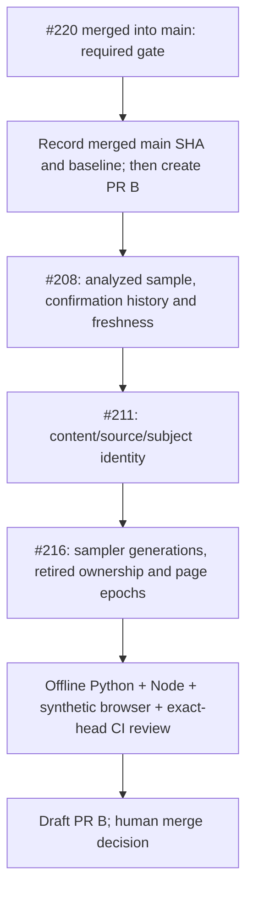

# PR B: perception freshness and identity extraction plan

Status: **PLAN ONLY. NO IMPLEMENTATION BRANCH.** PR #220 must be merged before
creating the PR B implementation branch. A green check, draft approval, or this
plan is not a merge event. PublicationContext OFF; Phase 5B NO-GO; V6 NO-GO;
zero new provider requests and spend; no production activation; #205 unchanged.

## Frozen inputs and dependency graph

| Input | Exact revision | Use |
| --- | --- | --- |
| Current `main` | `a79197b5cf20d4235861b46edeb20165f4112bed` | Current comparison baseline, not the future branch point |
| PR A / #220 | `77e51c797ddbc9df75a5eeeac73331d306cdd2e1` | Digest foundation and T6 RED plus fix together |
| #208 | `cfc130680fc0ca653c3b796406a5a97d05ef2dbe` | Screen confirmation freshness and immutable analyzed sample |
| #211 | `4d2dda0d3ef1adeccf4df58a007276b292c06469` | Content/source/subject dependence and ownership |
| Selected #216 | `62b58e2f89111fff2cfded8f96463b15f1e64006` | Perception lifecycle corrections only |

This graph describes extraction dependencies, not permission to merge the old
stack. #211 was stacked on #210, which was stacked on #209. Those ancestry
edges must not import their audio, commit, abstention or synthesis behavior.
Copy selected changes by responsibility into the post-#220 baseline; do not
merge, wholesale cherry-pick, rebase or force-push #208, #211 or #216.

Selected #216 implementation provenance:

- `3e9eb0f19e2dc81331befcb5216d7a34000d4180`: restarted sampler generation,
  reset sequence/media timestamps and retired sample/frame refusal.
- `cb3bd971cbf9ca4f6e3db43b228111441af99d89`: retired identities across subject
  reassignment and stale JavaScript completion versus its successor.
- `76f047bf58c47298f914560ba760a3909f3410bb`: page session/epoch identity,
  clock reset, in-flight drain/decode checks and assignment refresh.

These commits are reference material, not a list of commits to apply blindly.
Their historical reports do not count as test execution on the new branch.

## File-level allowlist

Only these production paths are candidates. If another path is necessary,
record the dependency and obtain a scope decision before expanding the port.

| File | Selected responsibility | Boundary |
| --- | --- | --- |
| `src/fakeyou/foundation/content_digest.py` | Immutable `ContentSample` continuity; generation and page identity on `DigestRecord` and `SampleSource` | No provider or renderer metadata |
| `src/fakeyou/foundation/publication.py` | `EvidenceBinding.analyzed`; pure confirmation/freshness decision and decision basis; `Dependence`; source/subject validation fields | Port the #208/#211 pure decision hunks only; retain #220's unrelated state/receipt APIs; no physical commit/writer or abstention-catalog import |
| `src/fakeyou/perception/samples.py` | `Ingested` outcome plus sample, bounded history, continuity, stopped state, scoped owner/retired identities and trusted page transitions | Preserve lower-sequence/media rejection within an incarnation; never accept an old page merely for its larger counter |
| `src/fakeyou/perception/context.py` | Bind the exact analyzed sample and its original capture mapping; current scene and camera availability | No remapping old captures using later exchanges; no model proposal/schema changes |
| `src/fakeyou/perception/revalidation.py` | Compare exact content, source continuity and subject ownership against page-scoped samples | Conservative undeclared screen dependence; camera identity is not inferred from matching pixels |
| `src/fakeyou/perception/timeline.py` | Store the actual admitted sample without re-ingesting it; retain analyzed capture; presenter tracking and page-scoped fallback/heartbeat provenance | Confirmation must not overwrite the analyzed capture, cached reading or original ownership |
| `src/fakeyou/perception/sensors.py` | Cache admitted samples only; bind frames to sampler/page identity; stop old confirmations; reject mixed/retired/in-flight batches before clock/roster ingestion | No meeting launch, service or configuration changes |
| `src/fakeyou/assets/perception.js` | Sampler generation and page-session tags across drain/messages/samples/frames/active records; replacement and stale completion handling | No live capture experiment or activation changes |

Candidate test paths:

- Adapt `tests/test_content_digest.py`, `tests/test_samples_ledger.py`,
  `tests/test_revalidation_match.py`, `tests/test_sensors_samples.py`,
  `tests/test_evidence_provenance.py` and `tests/test_camera_evidence.py`.
- Add/adapt `tests/test_publication_freshness.py`,
  `tests/test_publication_identity.py`, `tests/test_sensors_epoch.py`,
  `tests/test_sensors_generation.py` and `tests/perception_generation.mjs`.
- Retain `tests/test_publication_t6_regression.py` and run
  `tests/test_sensors_browser.py` unchanged first. Adapt browser fixtures only
  for the explicit page/session protocol, preserving their assertions.
- A new `tests/_perception_publication_fakes.py` may hold pure timeline,
  mapped-clock, evidence and decision fixtures. Existing #208/#211 tests import
  `Meeting`/`ask` from `test_publication_activation.py`, and later revisions of
  that helper import renderer/claim machinery. Do not copy that later helper.
  Keep decision and sensor tests independent of superseded speech/proposal
  paths. Use #220's existing helper only for existing T6 integration coverage.

## Execution sequence after the merge gate

### 1. Establish the actual branch point

- [ ] Read #220 state and merge SHA from GitHub. If not merged, stop before
  branch creation. Record the remote `main` SHA after the merge; do not assume
  it equals #220's head, since the merge method may change it.
- [ ] Create an isolated branch from that exact `main`, not from any legacy
  stacked head. Record the interpreter, imported source paths, environment and
  baseline test log/JUnit hashes. Preserve every baseline failure as a failure;
  no skip, xfail, assertion removal or changed expected value to obtain green.

### 2. Extract confirmation freshness (#208)

- [ ] First port the pure freshness/control assertions and run them against
  the baseline. Record actual RED failures rather than assuming all rows fail.
- [ ] Port the coupled sample model, ledger, sensors, timeline, binding and
  decision changes together. `EvidenceBinding.digest` becomes `analyzed`;
  `SampleLedger.ingest` returns `Ingested(outcome, sample)`; sensor caches accept
  only admitted samples; timeline reuses that same `ContentSample`.
- [ ] Run the freshness/ledger/revalidation/provenance tests and existing T6
  regression. Capture every result, including failures. Commit this coherent
  unit only after its tests and import/type checks are reviewed.

### 3. Extract identity (#211)

- [ ] Port identity decision tables and ownership/stream replacement controls;
  record their RED behavior before the implementation.
- [ ] Add `Dependence` and source/subject checks. An exact returned screen can
  support explicitly content-dependent evidence; it cannot establish original
  source continuity. Undeclared screen dependence remains conservative. A
  replacement camera/participant does not inherit the old subject's claim.
- [ ] Run the identity and freshness tables together, including both valid
  content cases and prevented source/subject cases. No speech renderer is
  needed to establish these pure decisions.

### 4. Extract lifecycle corrections (selected #216)

- [ ] Port reset, stale-generation, reassignment and page-epoch tests first.
  Include generation 8/sequence 500 on page A followed by generation 1/sequence
  1/reset media timestamp on page B, plus late page-A packets with generation 9.
- [ ] Port the three selected commits' perception behavior as one compatible
  lifecycle unit. Use `(page_epoch, page_session, stream_id, generation)` for
  incarnation/cache comparison and page-scoped ownership lookup. Keep trusted
  epoch transitions separate from untrusted packet counters.
- [ ] Run Node VM tests against the actual asset and sensor tests covering
  suspension, mixed parts, clock replacement and assignment refresh. Run the
  four synthetic browser controls offline with a cached binary, no warmup and
  non-local network egress denied. Any real-page stability/performance claim
  remains unmeasured.

### 5. Review the extracted result

- [ ] Run the full authorized offline suite, Ruff check/format, mypy,
  import-linter and deptry. Run focused controls together and retain baseline
  failure records even if isolated reruns differ.
- [ ] Compare the final file list against the allowlist and exclusions. Check
  #205 and settings byte-for-byte; verify PublicationContext remains OFF.
- [ ] Open a draft PR B only after the merge gate was satisfied. Collect CI for
  its exact head, publish a new extraction report and await human merge review.
  Do not edit historical audit/evaluation results or promote their 98/20/1
  classification to acceptance of the new extraction.

## Negative controls: planned, not executed on PR B

| Control | Trigger | Required observation / reference |
| --- | --- | --- |
| B-01 | One figure changes below thumbnail threshold | Current claim prevented; existing T6 / NC-01 remains passing |
| B-02 | Analyzed capture old; exact fresh confirmation | Pure content decision follows #208 table; analyzed capture unchanged |
| B-03 | Capture/confirmation at 5 s uncertainty edge | `unknown`, never a falsely fresh `valid`; NC-05/06 |
| B-04 | Unmapped, foreign-clock, high-uncertainty, future or pre-analysis confirmation | No valid confirmation; NC-07–10; no later remapping of A |
| B-05 | Missing hash, budget skip, repeated media time, lower sequence or inconsistent capture | Previous digest not reused; no freshness renewal; NC-15–18/34 |
| B-06 | Source stopped and last confirmation old | No current valid decision; NC-11 |
| B-07 | Identical screen after restart, another presenter, or intervening slide | Explicit content decision may hold; source and undeclared dependence unknown; NC-22–25 |
| B-08 | Camera replaced, another participant owns stream, or camera stopped | Subject/scene invalid; matching pixels insufficient; NC-26/27/33 |
| B-09 | Camera motion or new person | Conservative decision retained; no new current-camera speech policy; NC-28–31 |
| B-10 | New stream/sampler with reset sequence and media timestamp | New incarnation accepted; old one still retired |
| B-11 | Retired sampler packet/frame relabelled to another subject | Rejected; does not update freshness or owner |
| B-12 | Old JavaScript pump completes after reassignment | Successor remains active; old completion cannot stop it |
| B-13 | New page resets generation 8 to 1; old page sends generation 9 | New page admitted, old page refused; same-page generation regression still refused |
| B-14 | Mixed old messages/samples/frames/active records in new batch | Whole batch refused before clock, roster or sample mutation |
| B-15 | Drain/decode awaits while Python epoch changes | Old result/remainder refused; no stale frame/cache admission |
| B-16 | Reload with same stream assignments | New clock mapping and refreshed assignment required; analyzed mapping immutable |
| B-17 | Reused stream ID after page replacement | Historical owner lookup remains attributed to its original page |

These are decision/sensor controls. A `valid` pure decision is not authorization
to synthesize, commit or write PCM and does not resolve V6.

## Explicit exclusions and authorization boundaries

- No #209 audio commit/writer code, writer timestamps, bounded-write claims,
  PulseAudio alternatives, deadline workaround, lead/prebuffer or new spike.
- No #210 abstention catalog, #212 claim matcher, #213 render-only speech,
  #214 historical fallback/synthesis or #215 product evaluation implementation.
- Exclude #216 commits `19ad3ff5`, `df421c86`, `be093039`, audio/speech/actor/
  turn-graph/visual-speech paths, and conflict probe. The r2/r3 reports remain
  historical reference only, not new measured evidence.
- No NC-76/I7 reinterpretation, typed proposal/schema/prompt change, provider
  ledger experiment, new cassette, data relabeling or weakened matcher.
- No settings/default/SLO change, storage/deployment/Compose change, real Meet
  page, live provider call, spending, production activation or Phase 5B.
- Do not close, merge or force-push #206–#218. Do not change #205. PR #220 is
  still draft and unmerged when this plan is written; its merge is a separate
  authorization decision. This document creates no PR B implementation branch.
