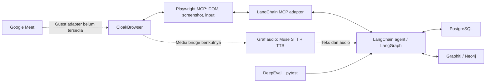

# Arsitektur Digital Twin

## Batas setup pertama

Fakeyou menyusun library yang sudah ada menjadi fondasi yang dapat diuji: agent, checkpoint, browser tools, voice services, memory client, dan evaluasi. Setup ini belum mengklaim bot Google Meet dengan audio/video dua arah telah berjalan. Link meeting, kredensial provider, persona, dan media transport diperlukan untuk pengujian live.

Python 3.12 dipakai untuk satu runtime bersama LangChain, LangGraph, dan Graphiti. Node menjalankan server Playwright MCP resmi. Dependency dikunci melalui uv dan npm.

## Pilihan

1. **Komposisi SDK dan MCP (dipilih):** LangChain/LangGraph mengatur agent; graf audio dan klien Muse sendiri mengatur suara; Playwright MCP mengoperasikan CloakBrowser; Graphiti menyimpan pengetahuan. Kode aplikasi terbatas pada konfigurasi dan composition root. Media Meet tetap perlu sambungan yang dibuktikan lewat pengujian live.
2. **Vexa sebagai layanan meeting:** mempercepat capture dan lifecycle, tetapi launcher CloakBrowser dan Muse perlu integrasi dengan runtime Node. Modul internal Vexa bukan otomatis SDK yang bisa dipasang dari registry.
3. **Attendee sebagai layanan:** menyediakan kontrak media yang luas, tetapi mengganti browser Selenium dan menyesuaikan lisensi perlu keputusan tersendiri. Dipakai sebagai referensi perilaku pada tahap ini.

## Komponen

Telinga memakai Muse Voice Transcribe lewat klien sendiri (`transcription/muse.py`). Mulut memakai layanan TTS yang berbeda (`speech/`) karena Muse hanya mengubah suara menjadi teks. Mata membaca DOM dan screenshot; pemahaman isi visual memerlukan model multimodal. Tangan memakai tool browser resmi: click, fill, keyboard, dan navigasi. Raise hand atau chat adalah alur produk di atas tool tersebut, bukan fitur yang otomatis selesai dengan pemasangan MCP.

LangGraph memiliki state percakapan dan checkpoint per thread. Graphiti memiliki fakta dan relasi lintas sesi. Simpan transcript final beserta provenance dan waktu kejadian; jangan mengekstrak pengetahuan dari setiap token transcript sementara. Pisahkan namespace setiap pemilik twin.

Jalur audio real-time tidak menunggu penyimpanan Graphiti atau evaluasi. Graf audio (`audio/graph.py`) berjalan per sesi di atas `PcmQueue` yang diisi browser Meet (`audio/stream_input.py`) atau capture PulseAudio dengan `parec` (`audio/capture.py`). Per chunk, graf memperbarui turn tap, mengirim audio ke STT, lalu menjalankan VAD Silero v5 (`audio/vad.py`) yang mengeluarkan event bicara; interupsi tetap diputuskan di loop percakapan. Pemilihan giliran berbicara dalam meeting multipihak tetap membutuhkan kebijakan produk di atas sinyal suara.

## Pattern dan batas kode

Gunakan composition root, dependency injection melalui objek SDK, dan context manager untuk resource. Hindari custom agent loop, memory database, retry framework, ataupun salinan browser tools. Nama fungsi dan tipe menjelaskan maksud tanpa komentar/docstring di source aplikasi.

## Keandalan

Browser dan sesi MCP hidup dalam satu context yang ditutup bersama. Checkpoint tidak menyimpan koneksi browser aktif; setelah restart proses perlu membuka resource baru. Aksi eksternal yang sudah terjadi tidak boleh diasumsikan aman untuk diulang karena checkpoint dapat memutar ulang node.

Guest entry mengikuti admission dan kebijakan host Google Meet. CloakBrowser membantu menjalankan browser; bukan jaminan admission. Isolasi profile dan kanal audio per meeting diperlukan sebelum menjalankan banyak bot. Setiap atribusi speaker harus menyimpan status unknown ketika tidak pasti.

## Verifikasi

Jalankan lint, type check, tes perilaku agent/checkpoint, evaluasi deterministik, dan smoke test browser lokal tanpa API key. Verifikasi live dipisahkan karena membutuhkan provider dan meeting nyata. Jangan menyamakan dependency yang berhasil diimpor dengan integrasi media end-to-end yang selesai.
